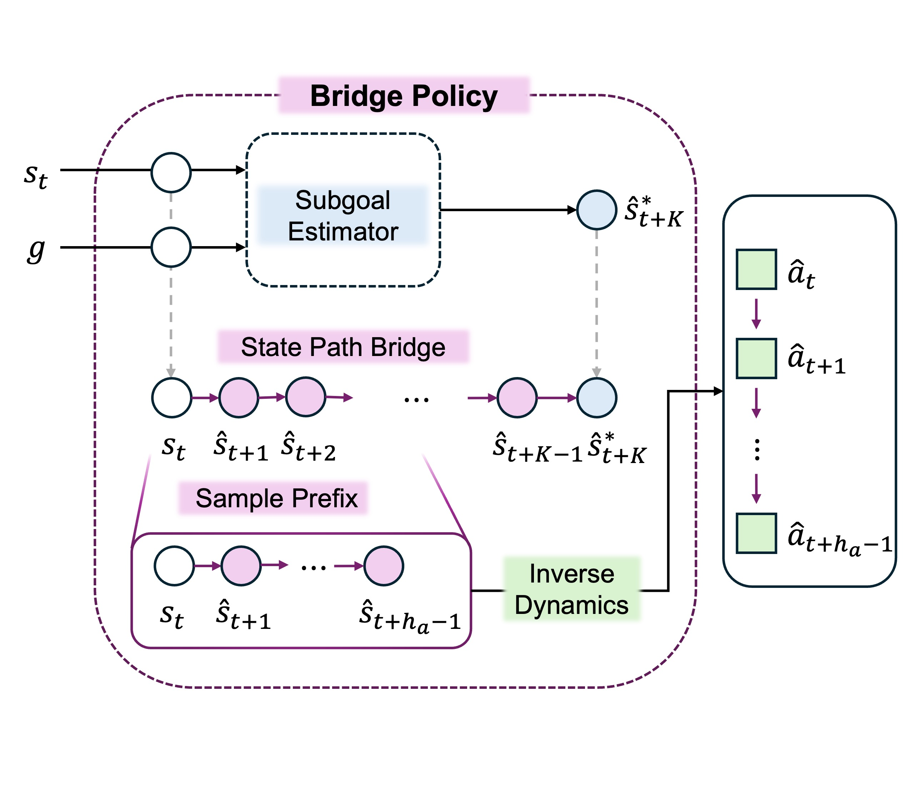

# PathBridger

Official implementation of **PathBridger: Subgoal Bridges for Offline
Goal-Conditioned Reinforcement Learning** for state-based OGBench tasks.

**Paper:** [arXiv:2608.29061](https://arxiv.org/abs/2608.29061)



PathBridger predicts a subgoal, constructs a state-space bridge, and decodes
its first transitions with an inverse-dynamics model. One runtime supports the
two paper methods:

- **PBF:** conditional rectified-flow endpoint proposer
- **PBG:** conditional diagonal-Gaussian endpoint proposer

## Installation

Python 3.10 or newer is required. Install the appropriate JAX build for your
accelerator, then install PathBridger:

```bash
git clone https://github.com/SChoish/PathBridger.git
cd PathBridger
pip install -e .
```

Optional Weights & Biases logging is available with `pip install -e ".[tracking]"`.

## Configurations

`configs/` contains exactly one paper-reproduction YAML per algorithm and
environment, named `{algorithm}_{environment}.yaml`. The eight environments
are AntMaze Medium/Large, Cube Single/Double/Triple, Puzzle 3x3/4x4, and Scene.
Each YAML is the complete paper-run preset used by training, evaluation, and inference.

Unknown YAML fields and unknown `--config_override=key=value` fields fail
explicitly. Every training run writes the fully resolved configuration and its
hash.

## Training

```bash
python main.py \
  --agent=configs/pbf_cube_double.yaml \
  --dataset_dir=/path/to/ogbench \
  --run_dir=/path/to/run \
  --seed=0
```

Use `configs/pbg_cube_double.yaml` for PBG. `dataset_dir` may contain local
`<env_name>.npz` and `<env_name>-val.npz` files; otherwise OGBench performs its
normal dataset resolution. A run writes `flags.json`, `resolved_config.json`,
`train.csv`, and `checkpoints/params_<step>.pkl` under `run_dir`.

## Evaluation

```bash
python evaluate.py \
  --agent=configs/pbf_cube_double.yaml \
  --checkpoint_dir=/path/to/checkpoints \
  --checkpoint_step=1000000 \
  --dataset_dir=/path/to/ogbench \
  --eval_protocol=historical-v1 \
  --episodes=50
```

`checkpoint_dir` accepts either an exact `params_<step>.pkl` file or a directory
paired with `checkpoint_step`. `episodes` is per task, and the default task
order is 1 through 5. `historical-v1` is the compatibility default;
`deterministic-v1` adds explicit task/episode seeding and must be selected
explicitly. Results are printed as JSON; `--output_path` saves the same record.

## Inference

Export an optimizer-free inference bundle:

```bash
python inference.py \
  --agent=configs/pbf_cube_double.yaml \
  --dataset_dir=/path/to/ogbench \
  --checkpoint_dir=/path/to/checkpoints/params_1000000.pkl \
  --export_path=/path/to/pathbridger.pkl
```

Run batch inference from the bundle:

```bash
python inference.py \
  --inference_bundle=/path/to/pathbridger.pkl \
  --input_path=/path/to/state_goals.npz \
  --output_path=/path/to/action_chunks.npz
```

The input NPZ contains `observations` and `goals` arrays with shape `[B, D]`;
inputs are converted to `float32` and `D` is checked against the bundle. The
output contains `float32` `action_chunks` with shape `[B, 5, A]`.

## Reproduction limits

Pretrained checkpoints and datasets are not bundled. The original run SHA was
not recorded, so these presets do not claim byte-identical historical training.
The PBG Scene preset is reconstructed from its surviving run record.

See [the reproduction guide](docs/reproduction.md) for the full preset table,
seed-ordered experiment commands, evaluation contracts, and the scope of the
implementation checks. [Optional extensions](docs/extensions.md) are documented
separately from the default PBF/PBG execution path.

## Ongoing research

We are investigating two follow-up directions that extend PathBridger:

- **Skill Learning and Composition:** Investigating how to learn reusable skills from offline trajectories and compose them for long-horizon goal-conditioned tasks.
- **Latent-Space Bridge Planning:** Exploring learned representations and geometrically structured latent spaces for goal-conditioned bridge generation and short-horizon execution.

## Citation

See [`CITATION.cff`](CITATION.cff).

## License

[MIT](LICENSE)
